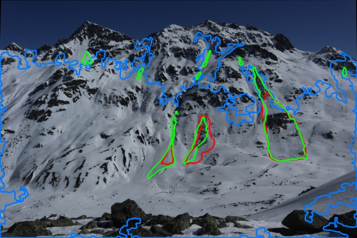

# Snow Movement Detection for Avalanche Early Warning

**Author:** Bircan Bektaş  
**Course:** Image Processing – Term Project  

## 📋 Project Description
This project detects snow movement and potential avalanche risk by comparing two images taken at different time intervals (e.g., 30 minutes apart).  
Unlike video-based systems, this approach works with periodic images from a fixed camera, making it suitable for real-world mountain monitoring.

## 🎯 Objectives
- Compare snow-covered mountain images
- Detect visual and snow density changes
- Detect whether snow moved downslope
- Assess avalanche risk level (LOW / MEDIUM / HIGH)
- Generate visual analysis results, from the command line or a web interface

## 🛠️ Technologies Used
- Python 3  
- OpenCV  
- NumPy  
- Streamlit (web interface)

## 🚀 Usage
Install the requirements:
```
pip install -r requirements.txt
```

### Web interface
```
streamlit run app.py
```
Use the sample images or upload your own two photos. The sidebar sets the downslope
direction and the part of the image to monitor.

### Command line
```
python avalanche_monitor.py                         # mountain_1.png vs mountain_2.png
python avalanche_monitor.py earlier.jpg later.jpg
python avalanche_monitor.py --roi 0,150,1194,550    # monitor only this rectangle
python avalanche_monitor.py --downslope 60          # fall line points down-right
```
- Instead of `--roi`, a black/white `roi_mask.png` (white = monitored area) can be placed
  next to the script.
- `--downslope` is the fall-line direction in the image: 0 = right, 90 = down (default),
  180 = left.
- The result is saved to `avalanche_analysis_result.jpg` (`--no-show` skips the window).

## 📊 Method Overview
1. **Image alignment** – ORB keypoints + RANSAC homography align the second image
   onto the first, so camera shake is not mistaken for snow movement.
2. **Region of interest** – only the monitored slope is analysed.
3. **Lighting / fog normalization** – CLAHE and brightness matching reduce the effect
   of fog and changing daylight.
4. **Snow detection** – bright and low-saturation pixels; the brightness threshold is
   chosen automatically with Otsu's method instead of a fixed value.
5. **Change detection** – illumination-invariant instead of plain brightness differencing:
   - *roughness* (local std / mean) is unchanged by a shadow but rises when smooth snow
     turns into rough avalanche debris,
   - *local correlation* (SSIM structure term) is unchanged by brightness scaling but
     drops when the surface pattern itself changes.

   Clear blue sky is masked out automatically; small regions (noise, snowflakes,
   people) are removed.
6. **Motion direction** – two independent clues:
   - *Optical flow* (Farneback) finds snow that slid even when its brightness hardly
     changed. Flow is trusted only where the surface has texture and the
     forward-backward check agrees, which filters out drifting fog.
   - *Region shape*: avalanche paths are long tongues along the fall line, measured
     with image moments (elongation and main axis angle).
7. **Risk classification** – based on the largest changed (or downslope-sliding)
   region, total changed area and snow coverage change:

   | Level  | Largest region | Total change | Snow change |
   |--------|----------------|--------------|-------------|
   | HIGH   | > 5 %          | > 10 %       | > 35 %      |
   | MEDIUM | > 1.5 %        | > 4 %        | > 20 %      |

   Downslope movement raises the risk by one level.

## 🧪 Test Results

### Synthetic tests
| Test case                                  | Detected by           | Direction     | Risk   |
|--------------------------------------------|-----------------------|---------------|--------|
| Sample images (camera shifted, fog)        | –                     | –             | LOW    |
| Synthetic small avalanche tongue (2 %)     | Texture + shape       | Downslope     | HIGH   |
| Synthetic large avalanche tongue (15 %)    | Texture + shape       | Downslope     | HIGH   |
| Synthetic snow slab sliding down 12 px     | Optical flow          | Downslope     | HIGH   |
| Synthetic snow slab moving up 12 px        | Optical flow          | Not downslope | LOW    |

- Before alignment, the camera shift alone produced 2.2 % false change.
- The sliding slab is invisible to change detection; only optical flow finds it.

### Evaluation on real webcam data (SLF Davos)
The synthetic tests only show that the pipeline behaves as designed. To see how it
performs on real cameras, it was evaluated on the expert-annotated SLF avalanche
webcam dataset ([Hafner 2024, EnviDat, CC BY-SA 4.0](https://doi.org/10.16904/envidat.526)).

- 54 unique images were grouped by camera view; consecutive images of the same view
  form **32 pairs** (30 minutes to several months apart).
- Ground truth "new avalanche" = annotated in the later image but not in the earlier one.
  11 pairs contain a new avalanche, 21 do not.

| Method                              | New avalanches detected | False alarms | Pixels of new avalanches found |
|-------------------------------------|-------------------------|--------------|--------------------------------|
| Brightness differencing (old)       | 11 / 11                 | 20 / 21      | 34.5 %                         |
| Texture-based (current)             | 7 / 11                  | 17 / 21      | 24.8 %                         |

Only the 30-minute pairs, the interval this project is designed for (5 pairs):

| Method                              | New avalanche detected  | False alarms |
|-------------------------------------|-------------------------|--------------|
| Brightness differencing (old)       | 1 / 1 (wrong location)  | 4 / 4        |
| Texture-based (current)             | 0 / 1                   | 1 / 4        |

**What this shows**
- The old method raised an alarm on almost every pair, so its "detections" are
  meaningless: moving sun shadows, clouds and day-to-day light changes all looked
  like change. Its one 30-minute detection marked trees in the foreground, not the avalanche.
- The texture-based method removes shadow false alarms on 30-minute pairs
  (3 of 4 negative pairs now correctly LOW). The remaining false alarm is caused by clouds.
- Real avalanches are small (0.2 – 5 % of the image) and are still mostly missed.
- With pairs days or weeks apart (new snowfall, melting, different light), simple
  image processing does not work.

**Limitations of this evaluation:** only 11 positive pairs (2 within a few hours), so
the numbers are rough. Thresholds were deliberately not tuned further on this small set,
to avoid overfitting.

**Conclusion:** classical image processing is not enough for reliable avalanche
detection on real webcams, so a deep-learning model was trained next.

### Deep learning comparison (U-Net)
A U-Net with an ImageNet-pretrained ResNet-34 encoder was trained to segment avalanches
in a single image ([notebook](deep_learning/avalanche_segmentation.ipynb), runs on a free
Google Colab GPU in about 30 minutes). A pair raises an alarm when the model finds
avalanche area (≥ 0.2 % of the image) in the later image that was not there in the earlier one.

- **Leave-camera-view-out:** the webcam images were split into 3 folds by camera view.
  Every image was evaluated by a model that never saw that view during training
  (training: ~36 webcam images + the hand-held photos of the dataset).
- Both methods were run on the same 34 pairs in the same notebook (13 with a new avalanche,
  21 without).

| Method                    | New avalanches detected | …at the right place | False alarms | Pixels of new avalanches found |
|---------------------------|-------------------------|---------------------|--------------|--------------------------------|
| Classical (texture-based) | 9 / 13                  | 7                   | 17 / 21      | 24.6 %                         |
| Deep learning (U-Net)     | 3 / 13                  | 2                   | **0 / 21**   | 7.7 %                          |

Per-image segmentation on unseen views: pixel precision 71 %, pixel recall 8 %, IoU 0.08.


*Green: new avalanches (expert annotation), red: U-Net, blue: classical pipeline.*

**What this shows**
- The model has learned what an avalanche looks like: it raised **no false alarm** on
  21 pairs, and 71 % of the pixels it marks are real avalanche. Shadows, clouds and
  snowfall, which fool the classical pipeline, do not fool it.
- But it is far too cautious: it finds only 8 % of avalanche pixels and misses most
  avalanches. With ~36 annotated webcam images per fold, the training data is very small.
- The classical pipeline "detects" more avalanches only because it raises an alarm on
  almost every pair.

**Next steps:** more training data (e.g. other public avalanche datasets), training at
higher resolution, and choosing the decision threshold on a separate validation set.

### Reproduce
```
# synthetic tests
python evaluation/make_synthetic_avalanche.py mountain_2.png
python evaluation/make_synthetic_slide.py mountain_1.png
python avalanche_monitor.py mountain_1.png avalanche_big.png

# real data (download ias_data.zip from EnviDat and unzip it first, ~2.9 GB)
python evaluation/prepare_slf.py <unzipped folder> prepared
python evaluation/evaluate_slf.py prepared results

# deep learning: open deep_learning/avalanche_segmentation.ipynb in Google Colab, Run all
```

## 📂 Project Structure
```
snow-detection/
├── avalanche_monitor.py           # analysis pipeline + command line
├── app.py                         # Streamlit web interface
├── evaluation/                    # synthetic tests + SLF real-data evaluation
├── deep_learning/                 # Colab notebook: U-Net vs. classical pipeline
├── requirements.txt
├── mountain_1.png
├── mountain_2.png
├── avalanche_analysis_result.jpg
└── README.md
```

## 📝 Note
This project is developed for educational purposes. Real avalanche monitoring systems require additional sensors and environmental data.
